 

  

  <b>AI & Full-Stack Developer</b> 
  Building intelligent applications, developer tools, and scalable software.
    
  <a href="https://atharvportfolio-eight.vercel.app/">Portfolio</a> &nbsp; · &nbsp;
  <a href="https://www.linkedin.com/in/atharv-dev/">LinkedIn</a> &nbsp; · &nbsp;
  <a href="https://x.com/AtharvShri37921">X</a> &nbsp; · &nbsp;
  <a href="mailto:atharv3444@gmail.com">Email</a>

---

## About

I'm Atharv, a B.Tech student in Artificial Intelligence & Data Science at ADYPU, Pune.

I enjoy engineering software that combines thoughtful product design with strong technical foundations. My interests span applied AI, multi-agent systems, backend architecture, distributed systems, and full-stack development.

I like working across the entire development lifecycle — understanding a problem, designing a solution, building the application, and making it usable.

**Current interests:** Agentic AI · Developer Tools · Distributed Systems · Backend Engineering

## Selected Work

<table>
<tr>
<td width="50%" valign="top">

<h3><a href="https://github.com/Atharvsrivastav/ai-career-twin">AI Career Twin</a></h3>

<b>Multi-Agent Career Intelligence</b>

An AI-powered career platform built around eight specialized agents.

Resume analysis, LinkedIn optimization, skill-gap assessment, personalized roadmaps, interview coaching, evaluation, market research, and career intelligence.

 
Next.js · FastAPI · PydanticAI · PostgreSQL · pgvector

  
<a href="https://ai-careertwin.vercel.app/">Live Application ↗</a>

</td>
<td width="50%" valign="top">

<h3><a href="https://github.com/Atharvsrivastav/IncidentGraphAI">IncidentGraph AI</a></h3>

<b>Distributed Systems & Observability</b>

An explainable incident investigation system for microservice architectures.

Directed dependency graphs, blast-radius analysis, deterministic root-cause ranking, fault simulation, and evidence-grounded AI investigation.

 
TypeScript · Next.js · PostgreSQL · OpenTelemetry · Grafana

  
<a href="https://incident-graph-ai.vercel.app/">Live Demo ↗</a>

</td>
</tr>
<tr>
<td width="50%" valign="top">

<h3><a href="https://github.com/Atharvsrivastav/DevPilot-AI">DevPilot AI</a></h3>

<b>AI-Powered Repository Intelligence</b>

A developer-tool project focused on understanding software repositories through code quality, security, architecture, performance, and maintainability analysis.

 
Next.js · TypeScript · FastAPI · PydanticAI · PostgreSQL

  
<a href="https://dev-pilot-ai-jade.vercel.app/">Live Demo ↗</a>

</td>
<td width="50%" valign="top">

<h3><a href="https://github.com/Atharvsrivastav/Ai-attendence-Risk-Predictor">AI Attendance Risk Predictor</a></h3>

<b>Machine Learning & Data Structures</b>

An academic project exploring attendance-risk prediction, recovery planning, explainable machine learning, and interactive algorithm concepts.

 
TypeScript · Next.js · Prisma · Machine Learning · DSA

  
<a href="https://github.com/Atharvsrivastav/Ai-attendence-Risk-Predictor">View Repository ↗</a>

</td>
</tr>
</table>

## Experience & Product Work

**BDX Datacentre — Student Intern**

Working on engineering workflows and exploring AI-assisted ticket triage and internal knowledge-intelligence solutions.

**Cogniv Solutions — Product Development**

Building digital products, AI-powered workflows, and software solutions.

[Website ↗](https://cognivsolutions.in)

**Innovance Solutions — Collaborative Development**

Contributed to Team Balancer, a sports-team coordination product focused on skill-balanced team generation and player management.

[Team Balancer ↗](https://balanceteams.com)

## Technical Toolkit

**Languages**

**Frontend & Application Development**

**Backend, AI & Data**

**Engineering & Infrastructure**

## Currently Building & Exploring

- **AI Repository Analyzer** — Exploring AI-assisted codebase understanding.
- **Agentic Systems** — Multi-agent orchestration and structured AI workflows.
- **Retrieval-Augmented Generation** — Embeddings, vector search, and contextual retrieval.
- **Systems Engineering** — Backend architecture, observability, reliability, and distributed systems.

## Connect

  
  
  
  
  

  Thoughtful engineering. Continuous learning. Useful software.

